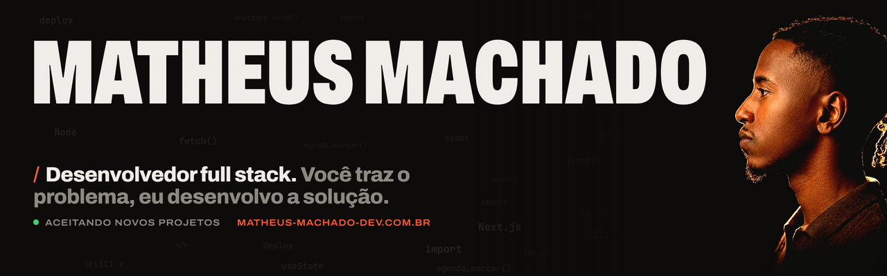

  
  
  

### Sobre mim

Sou desenvolvedor full stack: cuido do sistema inteiro, da tela que o cliente usa até o servidor que mantém tudo funcionando. Comecei na TI em 2022, passei de estagiário a desenvolvedor full stack na Ridolfinvest e hoje desenvolvo produtos completos e sistemas sob medida para negócios reais.

Nunca fui o cara com mais facilidade. **Fui o que mais treinou.** Tem coisa que eu não sei na hora, mas o que cai na minha mão eu vou atrás até resolver, e aprendo no caminho.

Formado em Análise e Desenvolvimento de Sistemas pela **FIAP** e fazendo MBA em Engenharia de Software na **USP**.

### Sistemas em produção

| Projeto | O que é | Stack |
|---|---|---|
| **[Abdou's Barber](https://abdousbarber.com.br)** | Gestão completa de uma barbearia de assinatura: agenda online, fila de espera, planos com cobrança automática, loja, financeiro e atendimento com IA no WhatsApp 24h. Tem [documentário do case](https://matheus-machado-dev.com.br/#case). | Next.js · TypeScript · Fastify · Prisma · PostgreSQL |
| **[Tô na Porta](https://tonaporta.app)** | Delivery com três lados (cliente, loja com tela de cozinha e entregador com rota), Pix e cartão com comissão automática e pedido em tempo real. | Next.js · Fastify · PostgreSQL · Mercado Pago · WebSocket |
| **[Psy Trekking](https://psy-trekking.com)** | Site em quatro idiomas com roteiros e reserva, mais painel financeiro dos guias. Lighthouse de 93 a 100. | Next.js · Fastify · PostgreSQL · Docker |
| **[Casa Cheia](https://casacheia.netlify.app)** | Lista de presentes em que o apartamento vai se enchendo a cada presente reservado, com cenas geradas por IA. | Astro · SolidJS · Netlify Functions · Gemini |

> O código desses sistemas é privado porque pertence aos clientes. Os sites estão no ar e os detalhes, com todas as telas, estão no [portfólio](https://matheus-machado-dev.com.br/#projetos).

### Projetos abertos

- **[flow-type](https://github.com/Matheus-Machaado/flow-type)**: ditado por voz para o Windows, a sua voz vira texto em qualquer aplicativo. Electron, TypeScript e React.
- **[portfolio-2026](https://github.com/Matheus-Machaado/portfolio-2026)**: o meu portfólio, em HTML, CSS e JavaScript puros, com player de vídeo próprio.

### Com o que eu trabalho

  

**Integrações em produção:** WhatsApp com IA · Mercado Pago · PagBank · Google Gemini · Google Maps · Resend · robôs, web scraping e OCR

---

Tem um problema no seu negócio? Me chama no <a href="https://wa.me/5511910254958">WhatsApp</a> e a gente transforma a sua ideia em uma solução real.
